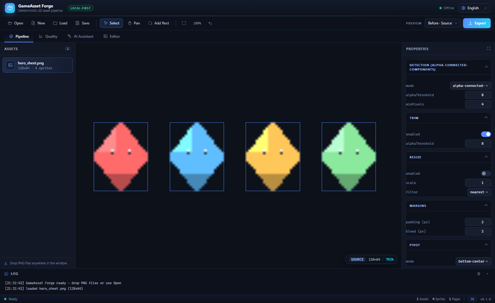
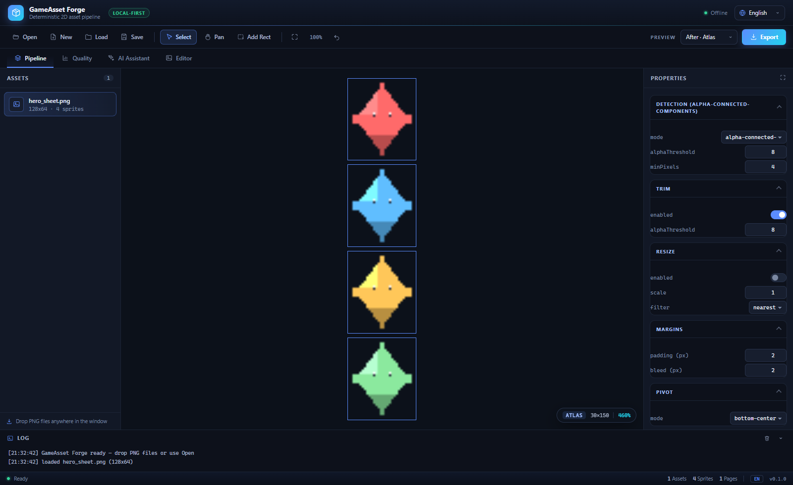
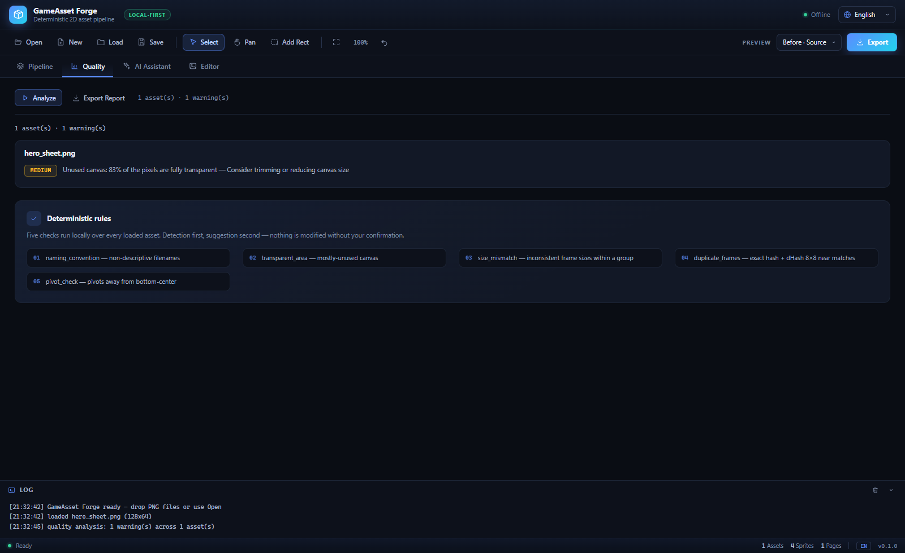

# GameAsset Forge

**Local-first, deterministic 2D game asset preparation.**

Turn raw PNG sprite sheets into game-ready atlases, manifests and engine
resources — repeatably, offline, with no AI required.



**English (default)** · [简体中文](README.zh-CN.md) · [Security Policy](SECURITY.md) · [License](LICENSE)

```text
sheet.png → detect → trim → resize → bleed/padding → pivot → atlas → export
                 └→ atlas-N.png + atlas.json (+ Godot .tres / Unity importer)
```

---

## Why

Hand-processing sprite sheets — slicing, trimming, padding, packing and
writing engine metadata — is repetitive, error-prone and different every time
a new asset pack arrives. GameAsset Forge turns that work into a **repeatable,
preset-driven pipeline**: same input + same preset = byte-identical output.

## Highlights

- **Deterministic & offline.** Core processing and the Quality Assistant use
  zero network I/O and no telemetry.
- **One preset, two front ends.** The CLI and the desktop GUI call the same
  `parsePreset → runPipeline → serializePreset` path and produce identical
  manifests (enforced by a consistency test).
- **Three detection modes**: alpha connected-components, uniform grid, and
  manual rectangles (a designed fallback, never an error).
- **Deterministic MaxRects atlas packing** with multi-page output, edge bleed,
  padding and normalized pivots.
- **Engine exports**: Godot 4 `SpriteFrames .tres` and a generated Unity
  Editor importer.
- **Quality Assistant**: five advisory rules with JSON + standalone HTML
  reports; detection first, suggestions second, nothing is auto-modified.
- **Optional AI Assistant**: off by default, mock-only in the GUI, schema
  validated and cached.
- **Modern bilingual desktop UI**: English by default, Simplified Chinese one
  click away.

## Screenshots

All screenshots below are captured from the real running renderer. The English
README uses English UI captures; the [Chinese README](README.zh-CN.md) uses
Chinese UI captures.

| Before · Source | After · Atlas |
| :-------------: | :-----------: |
|  |  |

**Quality Assistant** — warnings by asset, severity badges and the five
deterministic rules:



> To regenerate the captures: `npm run build && node scripts/capture-screenshots.mjs`.
> The same script with `--check` runs headless assertions without writing files
> (used in CI). Set `CHROME_PATH` if no local Chromium/Edge/Chrome is found.

## Architecture

npm-workspaces monorepo, TypeScript strict, ESM, Node.js >= 22.12:

| Package | Responsibility |
| ------- | -------------- |
| `packages/core` | Pure, IO-free pipeline: detect / trim / resize / bleed / pivot / pack / manifest / quality / transformation |
| `packages/cli` | Filesystem, PNG codec, commands, exporters, HTML reports |
| `packages/gui` | Electron desktop shell (main / preload / renderer) over the same core |
| `packages/ai` | Optional AI understanding, providers, validation and cache |
| `schemas/` | `preset.schema.json` — documented draft-07 contract |

Lint enforces that `core` knows nothing about Electron, PixiJS, Node or the
filesystem. Details in [docs/architecture.md](docs/architecture.md).

The GUI renderer is sandboxed: `contextIsolation: true`,
`nodeIntegration: false`, and all filesystem access goes through the narrow
`window.forge` preload bridge.

## Installation

```bash
npm ci
npm run build
```

## Quick start (CLI)

```bash
npm run cli -- init                                   # write a default preset.json
npm run cli -- inspect assets/player.png             # analyze without exporting
npm run cli -- validate preset.json                  # validate a preset only
npm run cli -- process assets/player.png -p preset.json -o out/
npm run cli -- batch assets/ -p preset.json -o out/ # recursive
npm run cli -- analyze assets/ -o report/           # Quality Assistant
npm run cli -- ai analyze assets/ -o out/           # optional AI understanding
npm run cli -- transform player.png -o out/         # cutout prototype
```

Exit codes: `0` success · `1` processing failure · `2` invalid
input/preset/usage. `batch` writes a `summary.json` with totals, errors and
duration. `output.format` in the preset selects which artifacts are written
(`["png","json"]` by default, or just one of them).

### Desktop GUI

```bash
npm run dev -w @gameasset-forge/gui
```

Drop PNG files, inspect detected rectangles, tune every pipeline parameter,
draw manual rects, switch between **Before (Source)** and **After (Atlas)**,
then Export. The Quality and AI Assistant pages reuse the same core functions
as the CLI.

**Language:** English is the default. Use the language selector in the title
bar to switch to 简体中文; the choice is persisted locally. `?lang=zh` /
`?lang=en` overrides it (used for documentation captures).

**Keyboard:** `V` select · `P` pan · `R` draw rect · `Delete` remove selected
manual rect · `Ctrl/Cmd+Z` undo · mouse wheel zoom · middle-drag or
Shift-drag pan. Shortcuts are ignored while a text field has focus.

## Presets

A preset is a saved instance of the pipeline. `schemaVersion` 1 files migrate
automatically; see [schemas/preset.schema.json](schemas/preset.schema.json).

```json
{
  "schemaVersion": 2,
  "detect": { "mode": "alpha-connected-components", "alphaThreshold": 8 },
  "trim": { "enabled": true },
  "resize": { "enabled": false, "scale": 2, "filter": "nearest" },
  "padding": { "pixels": 2 },
  "bleed": { "pixels": 2 },
  "pivot": { "mode": "bottom-center" },
  "atlas": { "maxWidth": 2048, "maxHeight": 2048, "algorithm": "maxrects", "spacing": 2 },
  "output": { "format": ["png", "json"], "godot": { "enabled": true } }
}
```

## Pipeline details

**Detection** — `alpha-connected-components` (default): foreground = alpha ≥
threshold, 8-connectivity labelling, min-pixel filter, deterministic ordering.
`grid`: rows+columns or cellWidth+cellHeight, empty cells dropped. `manual`:
user rectangles, bounds-checked. RGB PNGs work with grid/manual; alpha-CC
reports a clear error.

**Atlas packing** — MaxRects (Best-Short-Side-Fit), sprites placed in input
order, ties resolve to the earliest free rect. Padding/bleed are baked into
each cell; `spacing` is the gap between cells. Pages are trimmed to their used
extent and overflow opens a new page automatically.

**Pivot** — normalized `[0,1]` against the trimmed content rect, top-left
origin. `center` = 0.5/0.5, `bottom-center` = 0.5/1.0, or a manual override.
Exporters convert to engine conventions; core stays engine-blind.

**Godot** — with `output.godot.enabled`, exports `atlas-N.png` + `atlas.json` +
`<name>_spriteframes.tres`. See [samples/godot-smoke/](samples/godot-smoke/);
run `npm run sample:godot` and verify headlessly with Godot 4.2+ or visually in
the editor.

**Unity** — with `output.unity.enabled`, exports a generated
`GameAssetForgeImporter.cs` Editor script that slices the atlas via
`TextureImporter` (built-in `JsonUtility`, no extra packages). Static
validation only; runtime verification requires Unity.

## Quality Assistant

`analyze` runs five deterministic rules over a folder of PNGs and writes
`quality_report.json` + a self-contained `quality_report.html`:

- `naming_convention` — non-descriptive filenames
- `transparent_area` — mostly-unused canvas (default ratio 60%)
- `size_mismatch` — deviant frame sizes within an animation group
- `duplicate_frames` — exact hash and dHash 8×8 near duplicates
- `pivot_check` — pivots away from bottom-center (info by default)

Configure via the preset's `quality` section. The GUI exposes the same
analysis on its Quality page, including an Export Report button.

## AI Assistant (optional, V3)

`gameassetforge ai analyze assets/ -o out/` writes three advisory artifacts —
`ai_report.json`, `classification.json`, `asset_metadata.json`. It never moves
or modifies source files; every suggestion is review-and-confirm, and results
are cached by image hash + name + prompt version + provider + model.

- **Off by default.** Without an `ai.config.json` (or with `AI_ENABLED=false`)
  only the built-in `mock` provider runs — deterministic, local, zero network.
- **Providers**: `mock` (default), `openai` (cloud — uploads images to a
  third-party service; requires `enabled: true` plus an API key env var),
  `local` (reserved).
- The GUI's AI Assistant page uses the local mock only, with an explicit
  privacy banner.
- Responses are schema-validated; malformed output is rejected and the
  pipeline continues untouched.

## Editor Mode (prototype)

The Editor page proposes layers from the active source, lets you paint
masks, and exports a `project.forge` document. This is a V4 prototype; see
the component docs for its current boundaries.

## Testing & CI

The suite covers core unit tests (in-memory), golden fixtures (7 synthetic
deterministic sheets), CLI integration (real process spawns in temp dirs),
GUI/Core/CLI consistency, GUI state, AI/cache/provider regressions, and
renderer smoke checks. Real-world CC0 fixtures auto-skip when
`fixtures-local/` is absent.

```bash
npm test                        # builds first, then runs everything
npm run typecheck               # all four packages
npm run lint                    # ESLint (core IO/UI isolation rules)
npm run format:check            # Prettier
UPDATE_GOLDENS=1 npm test       # deliberately regenerate golden files
GAF_WRITE_REAL_RESULTS=1 npm test
```

GitHub Actions runs two jobs on every push to `main` and on every pull
request:

- **`ci`** — Node.js 22 / 24 matrix: install, typecheck, lint, format
  check, full test suite (which builds), then an explicit build.
- **`renderer-smoke`** — installs a headless Chromium and runs
  `scripts/capture-screenshots.mjs --check`, asserting that both languages,
  the PixiJS canvas, sprite detection, the composed atlas view and the
  Quality page all render correctly.

## Limitations

- PNG input only (no JPG/WebP background keying yet).
- Packed sheets with touching sprites merge under connected-components — use
  grid/manual modes for those.
- Atlas pages are used-extent, not power-of-two.
- The Unity importer is statically validated. Its pivot is content-relative
  and therefore an approximation of Unity's cell-relative pivot when
  padding/bleed/resize enlarge the packed cell.
- The Godot smoke test needs Godot 4.2+ installed locally.
- The GUI exports the active source; multi-source batch stays in the CLI.
- Cutout mesh triangulates the longest outer contour only; PatchMatch
  completion is a prototype (no multi-scale).

## Security

See [SECURITY.md](SECURITY.md) for supported versions, private vulnerability
reporting and the local-first threat model. Both the security policy and the
license are maintained in English.

## License

[MIT](LICENSE) (code). Fixture provenance and licenses:
[samples/README.md](samples/README.md) — all CC0, never commit unlicensed
assets.
