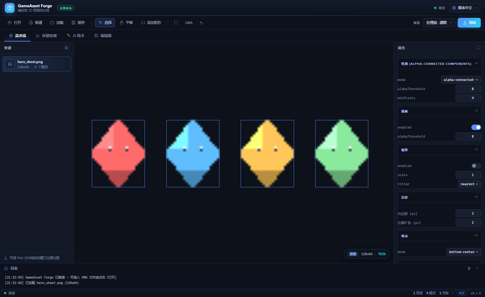
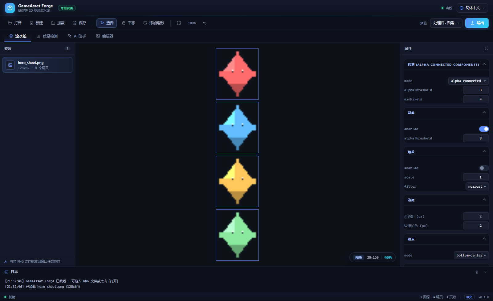
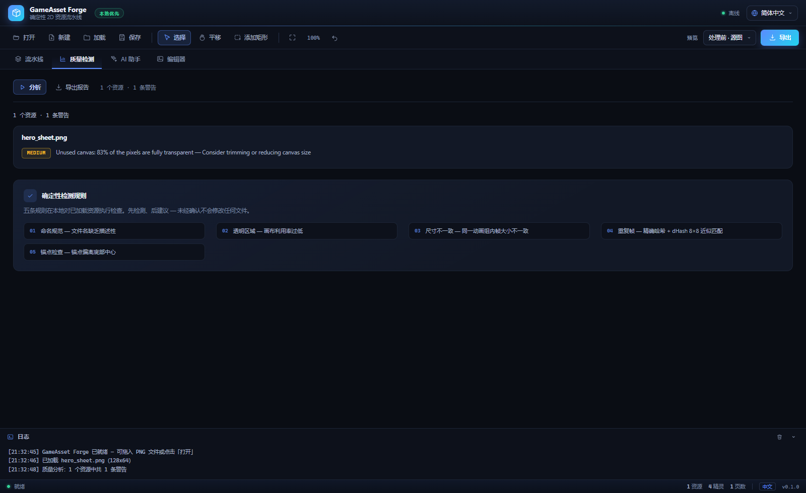

# GameAsset Forge

**本地优先、确定性可复现的 2D 游戏资源预处理流水线。**

把原始 PNG 精灵图转换为可直接用于游戏的图集、清单与引擎资源 —— 可重复执行、完全离线、无需 AI。



[English (default)](README.md) · **简体中文** · [Security Policy](SECURITY.md) · [License](LICENSE)

```text
sheet.png → 检测 → 裁剪 → 缩放 → 扩色/内边距 → 锚点 → 图集打包 → 导出
                 └→ atlas-N.png + atlas.json（+ Godot .tres / Unity 导入器）
```

---

## 为什么需要它

手工处理精灵图（切分、裁剪、留白、打包、编写引擎元数据）既重复又容易出错，每来一套新素材都要重做一遍。GameAsset Forge 把这些工作变成**由预设驱动、可重复的流水线**：相同输入 + 相同预设 = 逐字节一致的输出。

## 核心特性

- **确定性、可离线。** 核心处理与质量检测完全不访问网络，也不收集任何遥测数据。
- **一套预设、两个前端。** 命令行与桌面 GUI 调用同一条 `parsePreset → runPipeline → serializePreset` 路径，产出完全一致的清单（由一致性测试保证）。
- **三种检测模式**：Alpha 连通域、均匀网格、手动矩形（这是设计好的降级路径，不是错误）。
- **确定性 MaxRects 图集打包**，支持多页输出、边缘扩色、内边距与归一化锚点。
- **引擎导出**：Godot 4 `SpriteFrames .tres` 与自动生成的 Unity 编辑器导入脚本。
- **质量检测助手**：五条建议型规则，输出 JSON + 独立 HTML 报告；先检测、后建议，绝不自动修改文件。
- **可选 AI 助手**：默认关闭，GUI 内仅使用本地 mock，响应经过 schema 校验并带缓存。
- **现代化双语桌面界面**：默认英文，一键切换简体中文。

## 界面截图

以下截图均来自真实运行的界面。中文 README 使用中文界面截图，[英文 README](README.md) 使用英文界面截图。

| 处理前 · 源图 | 处理后 · 图集 |
| :-----------: | :-----------: |
|  |  |

**质量检测** —— 按资源展示警告、严重程度标记与五条确定性规则：



> 重新生成截图：`npm run build && node scripts/capture-screenshots.mjs`。
> 加上 `--check` 参数则只做无界面断言、不写文件（CI 使用此模式）。
> 若本机找不到 Chromium/Edge/Chrome，可通过 `CHROME_PATH` 指定浏览器路径。

## 架构

基于 npm workspaces 的 monorepo，TypeScript strict、ESM、Node.js >= 22.12：

| 包 | 职责 |
| -- | ---- |
| `packages/core` | 纯逻辑、无 IO 的流水线：检测 / 裁剪 / 缩放 / 扩色 / 锚点 / 打包 / 清单 / 质量检测 / 形变 |
| `packages/cli` | 文件系统、PNG 编解码、命令、导出器、HTML 报告 |
| `packages/gui` | 基于同一 core 的 Electron 桌面外壳（main / preload / renderer） |
| `packages/ai` | 可选的 AI 理解、提供者、响应校验与缓存 |
| `schemas/` | `preset.schema.json` —— draft-07 文档化契约 |

Lint 规则强制 `core` 不得依赖 Electron、PixiJS、Node 或文件系统。详见 [docs/architecture.md](docs/architecture.md)。

GUI 渲染进程处于沙箱中：`contextIsolation: true`、`nodeIntegration: false`，所有文件访问都通过收窄的 `window.forge` preload 桥接层完成。

## 安装

```bash
npm ci
npm run build
```

## 快速开始（命令行）

```bash
npm run cli -- init                                   # 生成默认 preset.json
npm run cli -- inspect assets/player.png             # 只分析、不导出
npm run cli -- validate preset.json                  # 只校验预设
npm run cli -- process assets/player.png -p preset.json -o out/
npm run cli -- batch assets/ -p preset.json -o out/ # 递归批处理
npm run cli -- analyze assets/ -o report/           # 质量检测助手
npm run cli -- ai analyze assets/ -o out/           # 可选 AI 理解
npm run cli -- transform player.png -o out/         # cutout 原型
```

退出码：`0` 成功 · `1` 处理失败 · `2` 输入/预设/用法错误。`batch` 会写出包含总数、错误与耗时的 `summary.json`。预设中的 `output.format` 决定写出哪些产物（默认 `["png","json"]`，也可只写其中一种）。

### 桌面 GUI

```bash
npm run dev -w @gameasset-forge/gui
```

拖入 PNG 文件、查看检测框、调整全部流水线参数、绘制手动矩形、在**处理前（源图）**与**处理后（图集）**之间切换，然后导出。质量检测页与 AI 助手页复用与命令行相同的 core 函数。

**语言**：默认英文。通过标题栏的语言选择器切换到简体中文，选择会保存在本地；也可用 `?lang=zh` / `?lang=en` 覆盖（文档截图使用此方式）。

**快捷键**：`V` 选择 · `P` 平移 · `R` 绘制矩形 · `Delete` 删除选中的手动矩形 · `Ctrl/Cmd+Z` 撤销 · 滚轮缩放 · 中键拖动或 Shift 拖动平移。输入框获得焦点时快捷键自动失效。

## 预设

预设是一份保存下来的流水线实例。`schemaVersion` 1 的文件会自动迁移，详见 [schemas/preset.schema.json](schemas/preset.schema.json)。

```json
{
  "schemaVersion": 2,
  "detect": { "mode": "alpha-connected-components", "alphaThreshold": 8 },
  "trim": { "enabled": true },
  "resize": { "enabled": false, "scale": 2, "filter": "nearest" },
  "padding": { "pixels": 2 },
  "bleed": { "pixels": 2 },
  "pivot": { "mode": "bottom-center" },
  "atlas": { "maxWidth": 2048, "maxHeight": 2048, "algorithm": "maxrects", "spacing": 2 },
  "output": { "format": ["png", "json"], "godot": { "enabled": true } }
}
```

## 流水线细节

**检测** —— `alpha-connected-components`（默认）：alpha ≥ 阈值视为前景，8 连通标记，最小像素过滤，顺序确定。`grid`：按行列数或单元格尺寸切分，丢弃空单元。`manual`：用户矩形，带边界校验。无 Alpha 的 RGB PNG 可使用 grid/manual；alpha-CC 会给出明确错误。

**图集打包** —— MaxRects（Best-Short-Side-Fit），按输入顺序放置，评分相同时选最早的空闲矩形。扩色与内边距烘焙进每个单元格，`spacing` 为单元格间距。页面按实际使用范围裁剪，放不下时自动开新页。

**锚点** —— 相对裁剪后内容矩形归一化到 `[0,1]`，左上角为原点。`center` = 0.5/0.5，`bottom-center` = 0.5/1.0，也可手动指定。导出器负责转换为各引擎约定，core 保持引擎无关。

**Godot** —— 启用 `output.godot.enabled` 后导出 `atlas-N.png` + `atlas.json` + `<name>_spriteframes.tres`。参见 [samples/godot-smoke/](samples/godot-smoke/)：执行 `npm run sample:godot`，再用 Godot 4.2+ 无头验证或在编辑器中目视验证。

**Unity** —— 启用 `output.unity.enabled` 后生成 `GameAssetForgeImporter.cs` 编辑器脚本，通过 `TextureImporter` 切分图集（仅用内置 `JsonUtility`，无额外依赖）。目前只做静态校验，运行时验证需要 Unity。

## 质量检测助手

`analyze` 对一个目录内的 PNG 执行五条确定性规则，写出 `quality_report.json` 与自包含的 `quality_report.html`：

- `naming_convention` —— 文件名缺乏描述性
- `transparent_area` —— 画布利用率过低（默认阈值 60%）
- `size_mismatch` —— 同一动画组内帧尺寸不一致
- `duplicate_frames` —— 精确哈希与 dHash 8×8 近似重复
- `pivot_check` —— 锚点偏离底部中心（默认为 info 级）

通过预设的 `quality` 段配置。GUI 的「质量检测」页提供同样的分析，并带「导出报告」按钮。

## AI 助手（可选，V3）

`gameassetforge ai analyze assets/ -o out/` 写出三份建议型产物：`ai_report.json`、`classification.json`、`asset_metadata.json`。它绝不移动或修改源文件；每条建议都需要人工确认，结果按「图像哈希 + 名称 + prompt 版本 + 提供者 + 模型」缓存。

- **默认关闭。** 没有 `ai.config.json`（或 `AI_ENABLED=false`）时只运行内置 `mock` 提供者 —— 确定性、本地、零网络。
- **提供者**：`mock`（默认）、`openai`（云端，会把图像上传到第三方服务；需要 `enabled: true` 及 API key 环境变量）、`local`（预留）。
- GUI 的 AI 助手页只使用本地 mock，并展示明确的隐私提示。
- 响应经过 schema 校验；格式不合法的输出会被拒绝，流水线不受影响。

## 编辑器模式（原型）

「编辑器」页可从当前资源生成图层建议、绘制遮罩，并导出 `project.forge` 文档。这是 V4 原型，能力边界见组件文档。

## 测试与 CI

测试覆盖 core 单元测试（纯内存）、黄金夹具（7 张合成确定性精灵图）、CLI 集成测试（临时目录 + 真实子进程）、GUI/Core/CLI 一致性、GUI 状态、AI 缓存与提供者回归，以及渲染层冒烟检查。真实 CC0 素材在 `fixtures-local/` 不存在时自动跳过。

```bash
npm test                        # 先构建，再运行全部测试
npm run typecheck               # 四个包的类型检查
npm run lint                    # ESLint（含 core 的 IO/UI 隔离规则）
npm run format:check            # Prettier
UPDATE_GOLDENS=1 npm test       # 显式重新生成黄金文件
GAF_WRITE_REAL_RESULTS=1 npm test
```

GitHub Actions 在每次推送到 `main` 及每个 Pull Request 上运行两个 job：

- **`ci`** —— Node.js 22 / 24 矩阵：安装依赖、类型检查、lint、格式检查、完整测试（含构建），以及一次显式构建。
- **`renderer-smoke`** —— 安装无头 Chromium 并执行 `scripts/capture-screenshots.mjs --check`，断言双语界面、PixiJS 画布、精灵检测、合成图集视图与质量检测页均能正确渲染。

## 已知限制

- 仅支持 PNG 输入（暂无 JPG/WebP 背景抠图）。
- 精灵相互接触的图集在连通域模式下会合并，请改用 grid/manual。
- 图集页面按实际使用范围裁剪，不是 2 的幂尺寸。
- Unity 导入器仅做静态校验。其锚点是相对内容矩形的，当 padding/bleed/resize 放大打包单元格时，它是 Unity「相对单元格」锚点的近似值。
- Godot 冒烟测试需要本机安装 Godot 4.2+。
- GUI 只导出当前活动资源；多资源批处理仍由命令行负责。
- Cutout 网格目前只三角化最长外轮廓；PatchMatch 补全为原型（无多尺度）。

## Security

See [SECURITY.md](SECURITY.md) for supported versions, private vulnerability
reporting and the local-first threat model. The security policy and the
license are maintained in English only.

## License

[MIT](LICENSE) (code). Fixture provenance and licenses:
[samples/README.md](samples/README.md) — all CC0. Never commit unlicensed
assets.
